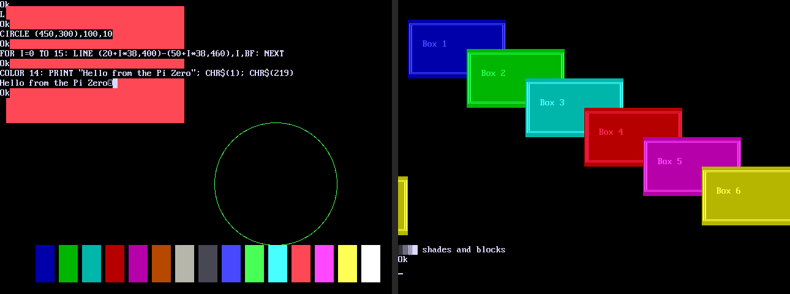

# Pi Zero BASIC

Ken Segler's [pico-basic](https://github.com/TheCodeman/pico-basic) running
bare metal (no OS) on the Raspberry Pi Zero W (BCM2835, ARM1176JZF-S), with
the console on both HDMI and the serial port, a USB keyboard, and its files on
the SD card.

This build is GPLv3, because the USB keyboard comes from the USPi library.

## The plan

1. **Boot and serial console** (done): the start-up code, the MMU and caches,
   the full ARM clock, the PL011 serial console and newlib.
2. **BASIC on the SD card** (done): `basic.c`, FatFs, the editors and XMODEM
   on a new `basic_port_rpi.c`, with the SD card (EMMC controller) as the drive.
3. **HDMI and USB keyboard** (done): a 640x480 framebuffer with the
   interpreter's screen features and pico-os's text console, and USPi for
   the keyboard and mouse. Text goes to both HDMI and serial, and keys come
   from either one.
4. **Sound and hardware commands** (done, waiting for a test on the board):
   BEEP, SOUND, PLAY and MUSIC over HDMI; PWM, I2C, SPI and COM1.
5. **Wi-Fi** (under way): the SD card moved to the SDHOST controller and the
   Wi-Fi chip on EMMC with `WIFI SCAN` (both working on the board); joining
   a network (WPA2), lwIP, DHCP and NTP (working on the board); MQTT
   (waiting for a test on the board).

## Building

You need `arm-none-eabi-gcc` with newlib (Debian/Ubuntu:
`sudo apt install gcc-arm-none-eabi libnewlib-arm-none-eabi`).

```bash
make            # build/kernel.img
make build/sd.img   # a 64 MB FAT32 card image with the examples, for QEMU
make qemu       # runs it in QEMU's raspi0 model (with build/sd.img if it's there)
```

`make qemu` opens a window with the HDMI screen and a USB keyboard; the
serial console is on the terminal (Ctrl-A X quits).



## The SD card

Format a card as FAT32 and copy these files to it:

- `bootcode.bin`, `start.elf` and `fixup.dat` from the `boot/` folder of
  [raspberrypi/firmware](https://github.com/raspberrypi/firmware/tree/master/boot)
- `sdcard/config.txt` from this repo
- `build/kernel.img`
- for Wi-Fi, a `firmware` folder with the Wi-Fi chip's three files, named
  as below, from
  [RPi-Distro/firmware-nonfree](https://github.com/RPi-Distro/firmware-nonfree/tree/c9d3ae6584ab79d19a4f94ccf701e888f9f87a53/debian/config/brcm80211)
  (Raspberry Pi OS has the same files in `/lib/firmware/brcm/`):
  - `firmware/brcmfmac43430-sdio.bin` (from `cypress/cyfmac43430-sdio.bin`)
  - `firmware/brcmfmac43430-sdio.txt` (from `brcm/brcmfmac43430-sdio.txt`)
  - `firmware/brcmfmac43430-sdio.clm_blob` (from `cypress/cyfmac43430-sdio.clm_blob`)

## The serial console

Use a 3.3 V USB-serial adapter, 115200 baud, 8N1:

| Zero W pin | To the adapter |
|---|---|
| 8 (GPIO14, TX) | RX |
| 10 (GPIO15, RX) | TX |
| 6 (GND) | GND |

Then run `picocom -b 115200 /dev/ttyUSB0` (ANSI or VT100 with UTF-8, at
least 80 x 30, as for pico-basic). You get the banner and BASIC's `Ok`.

`config.txt` takes the PL011 back from Bluetooth (`dtoverlay=disable-bt`) and
fixes its clock at 48 MHz (`init_uart_clock`).

## Using it

It is pico-basic, so its manual holds
([BASIC_MANUAL.md](https://github.com/TheCodeman/pico-basic/blob/main/docs/BASIC_MANUAL.md)),
with these differences:

- **Files** are on the SD card, the one drive (`SD:`), next to the
  firmware's own files. `SAVE`, `LOAD`, `FILES`, `OPEN`, `MKDIR`, `KILL` and
  the rest work as on the Pico. `AUTORUN.BAS` in the card's root runs at
  power-up (Esc or Ctrl-C within a second skips it).
- **Settings** are in `SD:/BASIC.CFG` (the Pico's `CONFIG.TXT`, renamed,
  because the card's `config.txt` is the firmware's): `TZ`, `CLOCK`,
  `WATCHDOG` and so on.
- **Getting files on and off:** paste a listing at the `Ok` prompt, or use
  `XRECV` and `XSEND` (XMODEM, YMODEM, ZMODEM) as on the Pico. Or put the
  card in the PC.
- **The screen and keyboard:** the HDMI screen shows the same as the serial
  terminal (80 x 30 text), and `SCREEN`, `LINE`, `CIRCLE`, `PAINT`, pages,
  `IMAGE` (BMP, PNG, JPEG) and `SAVEIMAGE` draw on it as on pico-os. Type on
  either the USB keyboard (US layout) or the serial terminal. Plug the
  keyboard into the Zero's USB socket (the one marked USB, through an OTG
  adapter) before power-up: USB devices are found once, at start-up. A mouse
  needs a hub for both; it has no wheel. Ctrl-Alt-Del restarts.
- **`EDIT`** opens the full-screen editor, on both.
- **Pins:** `PIN` and `PIN MODE` work on GPIO 0-27 of the header (14 and 15
  are the console). `PIN LED` is the green ACT LED (GPIO47). `TEMP()` is the
  SoC temperature. `PINS` draws the board and its 40-pin header, with what each pin is doing.
- **PWM** works on GPIO12 and 13 (header pins 32 and 33) and GPIO18 and 19
  (pins 12 and 35). 12 and 18 share one channel, and 13 and 19 the other,
  so a pair runs at one frequency.
- **I2C** is SDA GPIO2, SCL GPIO3 (pins 3 and 5), the default for
  `I2C OPEN`. GPIO0/1 (pins 27 and 28) are the second bus. A write with
  `NOSTOP` followed by a read is sent with a repeated start between them.
- **SPI** is SPI0: SCK GPIO11, MOSI GPIO10, MISO GPIO9 (pins 23, 19 and 21),
  the default for `SPI OPEN`. Drive the chip select yourself with `PIN`
  (GPIO8 and 7 are the usual ones).
- **COM1** borrows the serial console's UART and pins, GPIO14 TX and GPIO15
  RX (pins 8 and 10). While it is open, the serial console stops (the HDMI
  screen and the USB keyboard go on), and `CLOSE` gives it back. It needs a
  USB keyboard. RTS/CTS flow control is on GPIO17/16 (pins 11 and 36).
- **Sound** comes out of the HDMI monitor's or TV's speakers: `BEEP`,
  `SOUND`, `PLAY` and `MUSIC` (MOD and XM songs, with pico-os's players).
  This needs `hdmi_drive=2` in `config.txt` (it is in this repo's), so the
  firmware runs the link as HDMI, not DVI. The banner's `Sound:` line says
  if there is none (a DVI monitor, or one without speakers): then the
  commands run silently.
- **Wi-Fi:** put the network in `BASIC.CFG`:

  ```
  WIFI_SSID = MyNetwork
  WIFI_PASSWORD = my password
  WIFI_COUNTRY = US
  ```

  The Pi joins it at power-up (unless `WIFI = OFF`), in the background.
  `WIFI ON` starts the chip and joins, waiting until it is connected (Esc
  stops waiting), `WIFI` says how it is (the network, signal and IP
  address), `WIFI SCAN` lists the networks around and `WIFI OFF` turns the
  radio off. `WIFI(0)` is -1 when connected, `WIFI(1)` the signal in dBm,
  `WIFI(3)` the link's state as on the Pico W, `WIFI$(0)` the IP address and
  `WIFI$(1)` the network. Once connected, the clock is set by NTP
  (`NTP_SERVER`, pool.ntp.org by default; `NTP` asks again now and
  `WIFI(2)` is -1 once it has); `TZ` gives the local time. WPA2 (AES) and
  open networks work; the chip's firmware does the WPA2 handshake. A
  password can't hold `#`, `;` or `'` (they start comments in `BASIC.CFG`).
- **MQTT** as on the Pico W: `MQTT CONNECT "broker"[, port]`, `MQTT PUBLISH
  topic$, message$[, qos[, retain]]`, `MQTT SUBSCRIBE topic$[, qos]`,
  `MQTT UNSUBSCRIBE`, `MQTT DISCONNECT` and `MQTT` (the state). Messages that
  come in wait in a queue: `MQTT(1)` counts them, `MQTT$(0)` takes the next
  one's topic and `MQTT$(1)` its payload; `ON MQTT GOSUB` runs a line when
  one comes. With `MQTT = ON` and `MQTT_BROKER` (and `MQTT_PORT`,
  `MQTT_USER`, `MQTT_PASSWORD`, `MQTT_CLIENT_ID`) in `BASIC.CFG`, it
  connects by itself once Wi-Fi is up, and again if the connection drops.
- The Pi has no ADC (`ADC()` gives -1) and no PIO (no `NEOPIXEL`).
- The Pi has no clock that keeps time while it is off: `DATE$` and `TIME$`
  start at 1 Jan 1970 until NTP or a program sets them.
- **Memory:** about 450 MB for BASIC.

## The layout

| Path | What's there |
|---|---|
| `boot/start.S` | the entry point: stacks, vectors, VFP, BSS |
| `boot/link.ld` | loads at 0x8000; the stacks, then the heap up to the top of the ARM's RAM |
| `src/rpi/` | BCM2835 drivers: GPIO, system timer, UART, mailbox, MMU, reset, faults, newlib syscalls |
| `src/rpi/sdhost.c` | the SD card slot (the SDHOST controller; EMMC is left for the Wi-Fi chip) |
| `src/sd_disk.c` | FatFs's disk functions on the card, and its clock |
| `src/rpi/sdio.c` | SDIO on the EMMC controller, wired to the Wi-Fi chip |
| `src/rpi/wlan.c` | the Wi-Fi chip (CYW43430): bring-up, firmware, commands, events and scanning (after Richard Miller's ether4330.c for Plan 9) |
| `src/net/` | the network: lwIP on the Wi-Fi chip, joining, DHCP and SNTP (`net.c`), MQTT (`mqtt_port.c`), lwIP's settings |
| `lib/lwip/` | [lwIP](https://savannah.nongnu.org/projects/lwip/) 2.2.1 (BSD): the core, IPv4, SNTP and MQTT |
| `src/rpi/pins.c` | PWM, I2C (BSC) and SPI0 |
| `src/rpi/fb.c` | the HDMI framebuffer (640x480, RGB332 palette) |
| `src/rpi/hdmi_sound.c` | sound over HDMI: 48 kHz stereo into the HDMI audio FIFO by DMA (after Circle's driver, GPLv3) |
| `src/audio.c` | the sound mixer: tones, PLAY's queue and the music, as in pico-os |
| `src/mod/` | pico-os's MOD and XM players (MIT), as they are there |
| `src/rpi/ticker.c`, `src/rpi/irq.c` | the 100 Hz tick and its timers; interrupts |
| `src/terminal.c` | the terminal: output to serial and screen, keys from both |
| `src/usb_input.c` | the USB keyboard and mouse through USPi, and USPi's environment |
| `src/screen/` | pico-os's text console, pictures (lodepng, TJpgDec) and sprites (MIT), as they are there |
| `lib/uspi/` | [USPi](https://github.com/rsta2/uspi) (GPLv3), with three small changes marked "Pi Zero BASIC" |
| `src/basic_port_rpi.c` | `basic_port.h` for the Pi: what the interpreter needs from the board |
| `src/main.c` | board start-up, the banner, AUTORUN.BAS, BASIC's prompt |
| `src/basic/`, `src/fatfs/`, `src/term_editor.c`, `src/xfer.c`, `src/config.c` | pico-basic's own sources (MIT), as they are there |
| `src/compat/` | the few Pico SDK calls those use, on the Pi's timer |

The files from pico-basic are copied unchanged, except for FatFs's volume
names (just `SD`) in `ffconf.h` and a `PIZERO` case in `config.c`. Keep them
in step with pico-basic by copying them over again.
